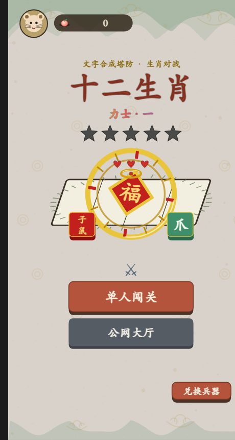
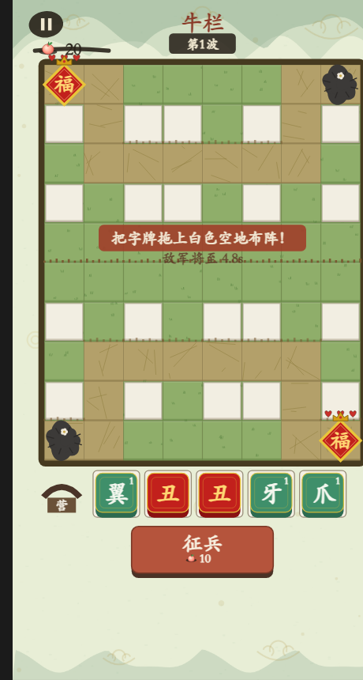
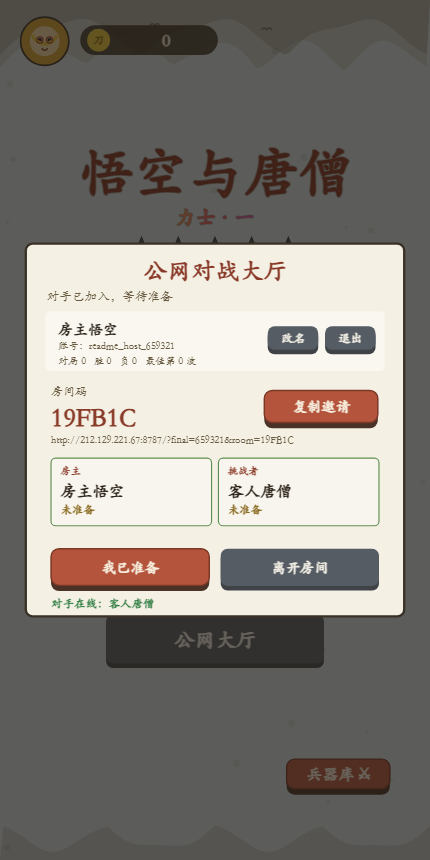
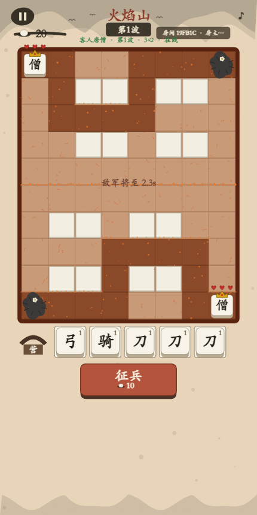

# 十二生肖

十二生肖是一款以中国传统生肖为主题的文字合成塔防游戏。游戏使用 Canvas 绘制，提供网页单人 AI 对战、网页端公网房间对战，并包含微信/抖音小游戏运行适配代码。

本文档是当前项目的主说明，集中记录玩法、开发运行、测试、部署和目录结构。具体行为以仓库源码为准。

## 游戏截图

| 开始界面 | 单人对局 |
| --- | --- |
|  |  |

| 公网大厅 | 公网对局 |
| --- | --- |
|  |  |

## 游戏玩法

- 战场为 8 × 10 格，上下两侧分别属于双方，敌人沿地图道路前进。
- 漏过敌人会损失守将红心；守将初始有 3 颗红心，红心耗尽即失败。
- 消耗仙桃征兵，获得兵种、生肖碎片或铲子；把兵种放到可建造格上布阵。
- 相同兵种、相同等级的单位可以合成升级，最高 5 级。
- 集齐同一武将的两个碎片后可觉醒该武将；每局从六位生肖武将中选出四位。
- 地图在鼠洞、牛栏、虎穴、兔窝、龙宫之间切换。
- 单人模式包含 AI 对手和 10 波关卡目标；公网 PvP 为无尽对战，不以第 10 波结束。

### 兵种

| 字 | 定位 | 配置基础伤害 | 攻击间隔（秒） | 配置射程 | 基础生命 |
| --- | --- | ---: | ---: | ---: | ---: |
| 爪 | 快速近战 | 16 | 0.75 | 1.35 | 120 |
| 角 | 坦克 | 24 | 0.95 | 1.8 | 110 |
| 牙 | 高伤害近战 | 34 | 1.15 | 1.5 | 150 |
| 翼 | 远程 | 13 | 0.55 | 3.2 | 80 |

等级成长和战斗细节由 [js/config.js](js/config.js) 及战斗模块配置；表中数值为配置基础值。

### 生肖武将

| 武将 | 觉醒碎片 | 技能方向 | 专属神器 |
| --- | --- | --- | --- |
| 子鼠 | 子 + 鼠 | 直线贯穿 | 鼠王金爪 |
| 丑牛 | 丑 + 牛 | 范围眩晕 | 伏牛铁角 |
| 寅虎 | 寅 + 虎 | 处决残敌 | 虎啸骨杖 |
| 卯兔 | 卯 + 兔 | 快速射击 | 玉兔玄弓 |
| 辰龙 | 辰 + 龙 | 友军攻击光环 | 龙宫明珠 |
| 巳蛇 | 巳 + 蛇 | 中毒与减速 | 灵蛇毒刃 |

### 兵器库兑换码

兑换码在本地游戏存档中记录，每个兑换码只能使用一次。当前源码配置如下：

| 兑换码 | 奖励品质 |
| --- | --- |
| `maojunzc666` | 良品（蓝色） |
| `maojunzc888` | 珍品（紫色） |
| `maojunzc999` | 神器（橙色） |

兑换内容按对应品质发放尚未拥有的武器。单机存档保存在当前浏览器/平台的本地存储中。

## 本地运行

### 网页版（含公网对战服务）

要求 Node.js 20 或更高版本。在项目根目录运行：

```bash
npm install
npm start
```

默认 HTTP 地址为 <http://localhost:8787/>，WebSocket 地址为 `ws://localhost:8787/ws`。该服务同时提供游戏静态文件和公网对战房间服务。

### 仅运行网页单机版

在项目根目录启动任意静态文件服务器，例如：

```bash
python -m http.server 8765
```

然后访问 <http://localhost:8765/>。自动对局调试入口为 <http://localhost:8765/?bot=1>。

静态托管可用于单机网页游戏；要使用公网对战，还需要单独运行 Node.js 房间服务，并给网页传入 WebSocket 地址，例如：

```text
https://你的静态站/?ws=wss://你的服务域名/ws
```

若网页和服务部署在同一域名且使用标准 `/ws` 路径，通常无需添加 `ws` 参数。HTTPS 网页必须使用 `wss://` 连接公网服务。

## 公网房间对战

1. 打开网页并进入「公网大厅」。
2. 注册账号或登录已有账号。
3. 创建房间，并把邀请链接或房间码发给另一位玩家。
4. 对方通过链接或房间码加入；双方准备后开始对战。
5. 对局结束后，服务端保存账号统计和最近对局记录。

服务端支持两名玩家加入房间、在线/准备状态同步、对局快照转发和战绩记录。快速匹配、完整断线恢复和赛季排行榜目前不属于已实现功能。

## 服务端部署

公网房间服务由 `server/online-server.js` 提供。默认监听 `0.0.0.0:8787`，WebSocket 路径为 `/ws`。可使用以下环境变量：

| 变量 | 默认值 | 用途 |
| --- | --- | --- |
| `PORT` | `8787` | HTTP 与 WebSocket 监听端口 |
| `HOST` | `0.0.0.0` | 服务监听地址 |
| `ONLINE_DATA_FILE` | `data/online-store.json` | 账号、会话及对局数据文件 |

Linux/macOS 示例：

```bash
ONLINE_DATA_FILE=/var/lib/shiershengxiao/online-store.json PORT=8787 npm start
```

PowerShell 示例：

```powershell
$env:ONLINE_DATA_FILE = "D:\data\shiershengxiao\online-store.json"
$env:PORT = "8787"
npm start
```

生产环境建议在 Node 服务前配置 HTTPS 反向代理，并为 WebSocket 转发 Upgrade 请求。Nginx 配置示例：

```nginx
server {
  listen 443 ssl;
  server_name game.example.com;

  location / {
    proxy_pass http://127.0.0.1:8787;
    proxy_set_header Host $host;
    proxy_set_header X-Forwarded-Proto $scheme;
  }

  location /ws {
    proxy_pass http://127.0.0.1:8787;
    proxy_http_version 1.1;
    proxy_set_header Upgrade $http_upgrade;
    proxy_set_header Connection "upgrade";
    proxy_set_header Host $host;
  }
}
```

部署前请确认服务器已安装 Node.js 20+，开放或代理了对应端口，并为 `ONLINE_DATA_FILE` 所在目录配置持久化存储和备份。仓库当前没有自动发布到 GitHub Pages 的 workflow；静态网页与联机服务需要按目标平台分别部署。

## 测试与模拟

运行项目自动化测试：

```bash
npm test
```

运行 AI 对局模拟或段位扫描：

```bash
node sim/run.js 0 1 0 100
node sim/sweep.js
```

`npm test` 使用 Node.js 内置测试运行器，覆盖服务端房间/账号流程、在线客户端状态、无尽模式规则、武将升级与兑换码等行为。

## 微信与抖音小游戏

- 微信开发者工具使用根目录作为项目目录，小游戏入口为 `game.js`，配置为 `project.config.json`。发布前将其中的 `appid` 替换为自己的 AppID。
- 抖音开发者工具可使用 `project.douyin.config.json` 作为配置模板；按文件说明复制/改名为 `project.config.json` 并填入自己的 AppID。
- `js/adapter.js` 和 `js/audio.js` 提供小游戏平台与浏览器之间的基础适配。请在各平台开发者工具中实际预览、真机测试，并按平台要求配置网络域名和审核信息。
- 网页公网对战依赖浏览器 WebSocket；小游戏端的联网能力与平台域名配置需另行验证，不能仅凭浏览器联机结果视为已完成平台发布验收。

## 项目结构

```text
index.html                    网页入口及脚本加载顺序
game.js                       微信/抖音小游戏入口
game.json                     小游戏配置
project.config.json           微信开发者工具配置模板
project.douyin.config.json    抖音开发者工具配置模板
js/adapter.js                 Canvas、触摸、存储和平台适配
js/config.js                  兵种、武将、武器、地图及游戏参数
js/map.js                     棋盘地图、路径和可建造格
js/render.js                  Canvas 绘制与界面渲染
js/audio.js                   音效播放
js/board.js                   兵种、备战席和合成逻辑
js/enemies.js                 敌人和行进逻辑
js/battle.js                  战斗、攻击与技能效果
js/ai.js                      单人 AI
js/rank.js                    玩家段位逻辑
js/weapon.js                  兵器库、装备和兑换码
js/ui.js                      页面、交互和游戏界面
js/online.js                  网页在线对战客户端
js/main.js                    游戏启动与主循环
server/online-server.js       HTTP 静态文件及 WebSocket 房间服务
server/online-server.test.js  服务端测试
test/                         游戏与客户端自动化测试
sim/                          无头对局模拟和平衡分析
tools/                        预览、调试、音效及渲染工具
audio/                        WAV 游戏音效
docs/screenshots/             项目说明使用的截图
```

## 文档说明

本 README 是项目玩法、运行和部署信息的唯一主说明。`audit_report.md`、`code-audit-report.md`、`AUDIT_FINAL.md` 是历史代码审计记录，不代表当前源码状态；其中引用的路径、结论应在采取行动前重新对照代码核实。
